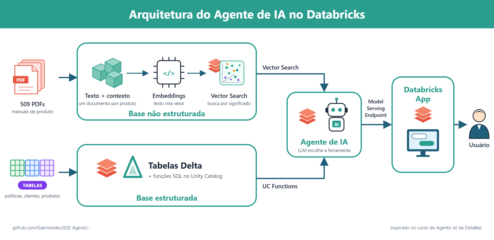
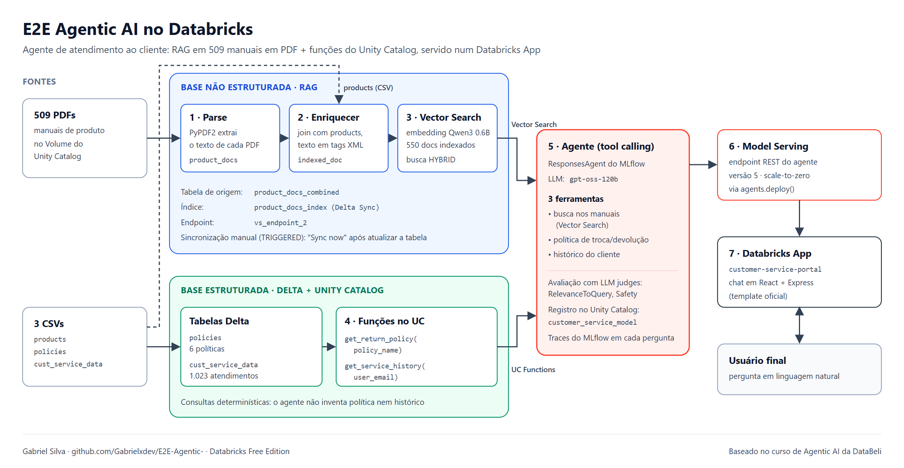
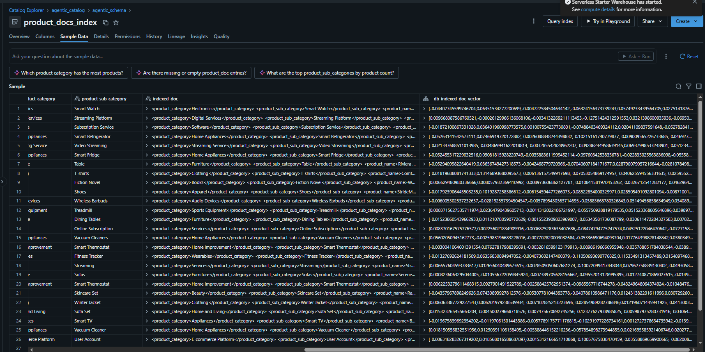
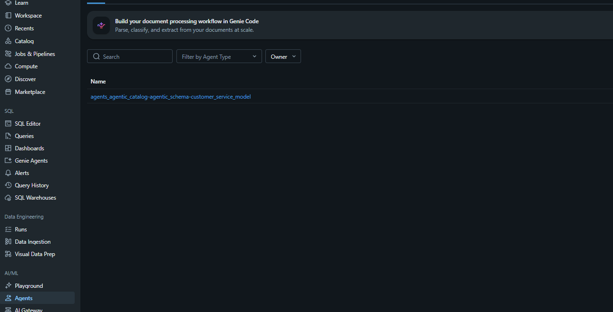
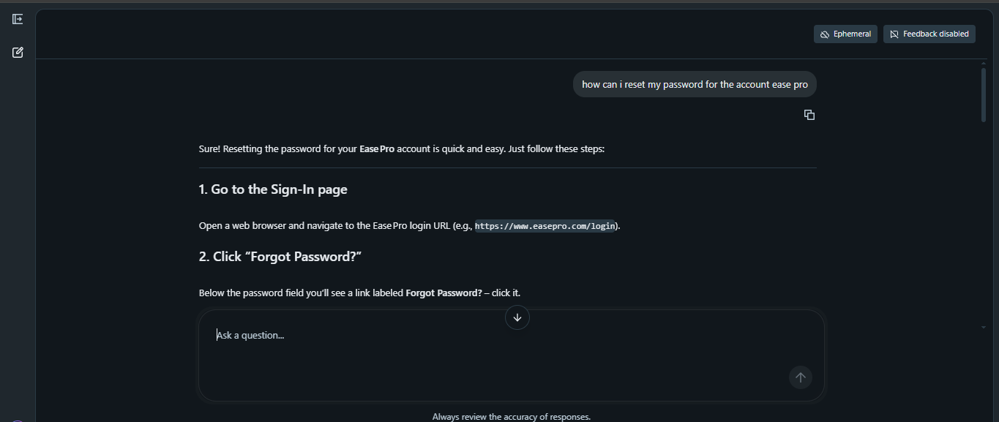

# E2E Agentic AI no Databricks

Agente de atendimento ao cliente construído de ponta a ponta no **Databricks Free Edition**. Ele responde
perguntas sobre produtos lendo **509 manuais em PDF** (RAG com Vector Search) e consulta **políticas da empresa e o
histórico do cliente** por funções do Unity Catalog. Depois de avaliado e registrado com MLflow, o agente é servido num
endpoint e fica disponível num **Databricks App** de chat.



---

## O que o agente responde

| Pergunta | Ferramenta que o agente escolhe |
|---|---|
| "Como redefino a senha da minha conta EasePro?" | busca nos manuais (Vector Search) |
| "Qual é a política de devolução?" | `get_return_policy` |
| "Quantas devoluções o cliente nicolas.pelaez@example.com já teve, e por quê?" | `get_service_history` |

O LLM decide sozinho qual ferramenta chamar (*tool calling*). Política e histórico vêm de consultas SQL, e não da
memória do modelo, por isso o agente não inventa regra nem número.

## Stack

| Camada | Tecnologia |
|---|---|
| Dados | Unity Catalog (Volume + tabelas Delta) |
| Extração de PDF | PyPDF2 em notebook Python |
| Busca semântica | Databricks Vector Search · embedding `databricks-qwen3-embedding-0-6b` · busca HYBRID |
| Ferramentas estruturadas | Funções SQL no Unity Catalog |
| LLM | `databricks-gpt-oss-120b` (Foundation Model APIs) |
| Agente | `ResponsesAgent` do MLflow + `databricks-openai` (`UCFunctionToolkit`, `VectorSearchRetrieverTool`) |
| Avaliação e observabilidade | MLflow 3 (`RelevanceToQuery`, `Safety`, traces) |
| Deploy | Model Serving (`agents.deploy`, scale-to-zero) |
| Interface | Databricks Apps · template `e2e-chatbot-app-next` (React + Express) |

## Arquitetura em detalhe

O mesmo fluxo com os nomes reais de cada tabela, índice, função e modelo:



## Os dados

Todo o projeto vive em `agentic_catalog.agentic_schema`.

| Objeto | Tipo | Linhas | Para que serve |
|---|---|---:|---|
| `customer_service` | Volume | 509 PDFs + 3 CSVs | arquivos brutos |
| `products` | tabela | 553 | catálogo (categoria, subcategoria, nome) |
| `product_docs` | tabela | 509 | texto extraído de cada PDF |
| `product_docs_combined` | tabela | 550 | produto + documento num texto só (`indexed_doc`) |
| `product_docs_index` | índice vetorial | 550 | busca semântica nos manuais |
| `policies` | tabela | 6 | políticas (troca, devolução, reembolso, garantia...) |
| `cust_service_data` | tabela | 1.023 | histórico de atendimentos por cliente |

---

## Passo a passo: do PDF ao app

### 1 · Conversar com um LLM — [`01_LLM_Interation`](01_LLM_Interation.ipynb)

O primeiro passo é provar que o workspace fala com um LLM. O notebook usa o cliente da OpenAI, mas aponta o
`base_url` para o **AI Gateway** do Databricks: a requisição não sai para a OpenAI, ela vai para o modelo
`gpt-oss-120b` hospedado e governado pelo próprio workspace. O token vem do contexto do notebook e nunca é escrito
no código.

### 2 · Extrair o texto dos PDFs — [`02_Parse_PDF_Docs`](02_Parse_PDF_Docs.py)

Os 509 manuais ficam num Volume do Unity Catalog. O notebook lista os arquivos, extrai o texto de todas as páginas
com PyPDF2 e grava uma linha por produto em `product_docs` (`product_name`, `product_doc`).

### 3 · Enriquecer o documento — [`03_Enrich_PDF_Files`](03_Enrich_PDF_Files.py)

Um manual sozinho não diz a qual categoria o produto pertence. O notebook junta `products` com `product_docs` e
monta a coluna `indexed_doc`, com cada campo delimitado por tags:

```xml
<product_category>Electronics</product_category>
<product_sub_category>Smart Watch</product_sub_category>
<product_name>...</product_name>
<product_doc>...texto do manual...</product_doc>
```

Assim o embedding carrega o contexto do produto junto com o conteúdo, e a busca acha o manual certo mesmo quando a
pergunta cita só a categoria.

### 4 · Criar o índice vetorial e testar a busca — [`04_Query_VS_Index`](04_Query_VS_Index.ipynb)

O índice `product_docs_index` é do tipo **Delta Sync** sobre `product_docs_combined`: chave `product_id`, coluna
`indexed_doc` transformada em vetor pelo modelo `databricks-qwen3-embedding-0-6b`, servido no endpoint
`vs_endpoint_2`. O notebook faz uma consulta **HYBRID** (vetor + palavra-chave) e devolve os 3 trechos mais próximos.



### 5 · Funções do Unity Catalog como ferramentas — [`05_Create_User_Defined_Functions`](05_Create_User_Defined_Functions.py)

Para dado estruturado, busca semântica é a ferramenta errada. Duas funções SQL ficam registradas no Unity Catalog,
com comentário em cada parâmetro: o LLM lê esses comentários para decidir quando e como chamá-las.

| Função | Entrada | Devolve |
|---|---|---|
| `get_return_policy` | `policy_name` | política, detalhes, data da última atualização |
| `get_service_history` | `user_email` | quantidade de ocorrências do cliente por categoria de problema |

> A coluna de saída se chama `returns_last_12_months`, como no curso, mas a consulta não filtra data: ela conta
> todo o histórico do cliente em `cust_service_data`. Para valer o nome, falta um `WHERE` na data do atendimento.

### 6 · Montar, avaliar e publicar o agente — [`agent/`](agent)

O agente nasceu no **AI Playground** (modelo + as 3 ferramentas) e foi exportado para código:

- [`agent/agent.py`](agent/agent.py): um `ResponsesAgent` do MLflow que chama o LLM, executa as ferramentas que ele
  pedir e devolve a resposta em streaming. Cada pergunta gera um trace no MLflow.
- [`agent/driver.py`](agent/driver.py): o notebook que testa o agente, registra o modelo declarando os recursos que
  ele usa (endpoint do LLM, funções e índice), avalia com os juízes `RelevanceToQuery` e `Safety`, registra no Unity
  Catalog como `agentic_catalog.agentic_schema.customer_service_model` e publica com `agents.deploy` (scale-to-zero).

O endpoint `agents_agentic_catalog-agentic_schema-customer_service_model` serve hoje a **versão 5**.



### 7 · Interface de chat — [`app/app-AI-Agent`](app/app-AI-Agent)

O app parte do template oficial `e2e-chatbot-app-next` (React + Express). Nenhum endereço fica escrito no código: o
`app.yaml` recebe o endpoint do agente como recurso (`valueFrom: serving-endpoint`), e o Databricks injeta a
autenticação. O app roda no modo efêmero, sem banco para guardar o histórico das conversas.



---

## Problemas que resolvi no caminho

**Endpoint respondendo 404 "does not exist".** O código exportado do Playground chamava o LLM pelo nome
`system.ai.gpt-oss-120b` (via AI Gateway), mas o driver declarava o recurso `databricks-gpt-oss-120b`. Depois do
deploy, o endpoint só tinha permissão no recurso declarado, e a chamada ao outro nome voltava como 404, como se o
modelo não existisse. A correção foi usar o **mesmo nome nos dois lugares**:

```python
LLM_ENDPOINT_NAME = "databricks-gpt-oss-120b"
client = DatabricksOpenAI()                                   # sem use_ai_gateway=True
resources = [DatabricksServingEndpoint(endpoint_name=LLM_ENDPOINT_NAME)]
```

Não era limite do Free Edition, era o nome do modelo diferente entre o código e o recurso declarado.

**Limite de versões no Free Edition.** A cota permite no máximo 2 versões servidas ao mesmo tempo no endpoint. Antes
de cada novo `agents.deploy`, foi preciso tirar as versões antigas da configuração do endpoint.

**Índice que não atualiza sozinho.** O índice está em modo *Triggered*: depois de mudar `product_docs_combined`, é
preciso clicar em **Sync now** no índice, senão o agente continua buscando no conteúdo antigo.

## Estrutura do repositório

```
E2E-Agentic-/
├── 01_LLM_Interation.ipynb              # 1. conversa com o LLM pelo AI Gateway
├── 02_Parse_PDF_Docs.py                 # 2. PDFs → product_docs
├── 03_Enrich_PDF_Files.py               # 3. product_docs + products → product_docs_combined
├── 04_Query_VS_Index.ipynb              # 4. consulta ao índice vetorial
├── 05_Create_User_Defined_Functions.py  # 5. funções do Unity Catalog
├── agent/
│   ├── agent.py                         # 6. o agente (ResponsesAgent + 3 ferramentas)
│   └── driver.py                        #    log, avaliação, registro e deploy
├── app/app-AI-Agent/                    # 7. app de chat (Databricks Apps)
└── docs/images/                         # diagrama e prints deste README
```

## Como reproduzir

1. Crie uma conta no [Databricks Free Edition](https://www.databricks.com/learn/free-edition).
2. Crie o catálogo `agentic_catalog`, o schema `agentic_schema` e o Volume `customer_service`. Suba a pasta
   `01_Data_Files` do [repositório do curso](https://github.com/databeli/databricks_course/tree/main/18_Agentic_AI)
   (PDFs em `product_docs/` + `products.csv`, `policies.csv`, `cust_service_data.csv`).
3. Carregue os 3 CSVs como tabelas Delta com os mesmos nomes (Catalog → Create table).
4. Clone este repositório como **Git folder** no workspace e rode os notebooks `02` e `03`.
5. Crie um endpoint de Vector Search e o índice `product_docs_index` sobre `product_docs_combined` (chave
   `product_id`, coluna `indexed_doc`, modelo `databricks-qwen3-embedding-0-6b`). Teste com o `04`.
   O `04` lê credenciais de service principal das variáveis `WORKSPACE_URL`, `SP_CLIENT_ID` e `SP_CLIENT_SECRET`.
6. Rode o `05` para criar as funções.
7. Rode `agent/driver.py` para testar, avaliar, registrar e publicar o agente.
8. Em **Compute → Apps**, crie um app a partir de `app/app-AI-Agent` e adicione o endpoint do agente como recurso
   `serving-endpoint` com permissão *Can query*.

## Créditos

- Projeto desenvolvido a partir do curso de **Agentic AI da DataBeli**
  ([vídeo](https://www.youtube.com/watch?v=F7CMlkxHE3o) ·
  [repositório](https://github.com/databeli/databricks_course/tree/main/18_Agentic_AI)). Os comentários didáticos
  dos notebooks e a correção do erro 404 são meus.
- O app vem do template oficial [`databricks/app-templates`](https://github.com/databricks/app-templates)
  (`e2e-chatbot-app-next`), que segue a licença daquele repositório.
- Diagrama de arquitetura próprio.

---

**Gabriel Silva** · [GitHub](https://github.com/Gabrielxdev)
